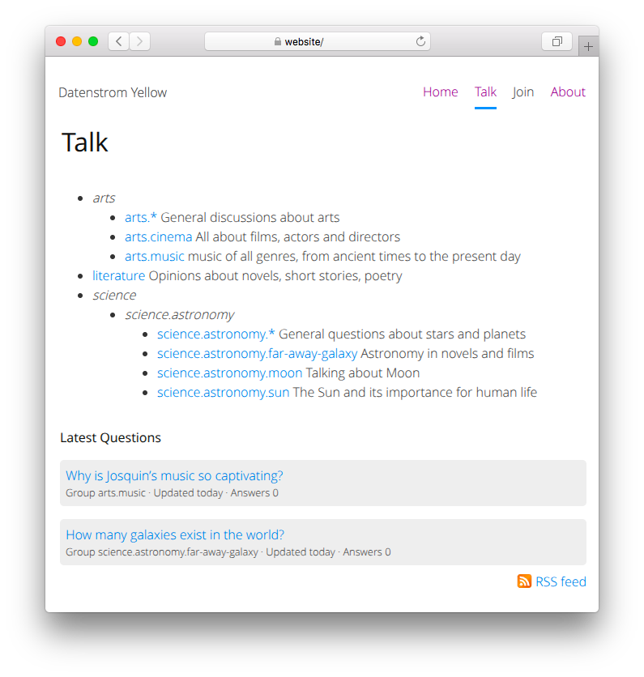

# Talk 1.0.0 alpha

Discussion forum. Developed by Giovanni Salmeri.

## How to install an extension

[Download ZIP file](https://github.com/giovannisalmeri/yellow-talk/archive/refs/heads/main.zip) and copy it into your `system/extensions` folder. [Learn more about extensions](https://github.com/annaesvensson/yellow-update).

Talk requires the [Restrict](https://github.com/giovannisalmeri/yellow-restrict/) extension. You could want to use also [Backtotop](https://github.com/giovannisalmeri/yellow-backtotop/) (for better handling of long pages), [Filelist](https://github.com/giovannisalmeri/yellow-filelist/) (for expandable groups list), [Mailer](https://github.com/giovannisalmeri/yellow-mailer/) (for more reliable mail sending).

## How to use a forum

The forum is available on your website as `https://website/talk/`. The access to the forum requires authentication. An example page with forms for subscription and unsubscription, instructions for RSS feeds and Markdown, and rules of conduct is available at `https://website/join/`.

## How to define groups

Before using the forum, you have to define some groups in the file `system/extensions/talk-groups.psv`, one for line, with the following format:

    group_name|description|moderator

The name of the group can contain dots to create a hierarchy (e.g. `science.astronomy.moon`). The description will be used in the page and in the feed of the group. The moderator (specified with the username) will be able to edit the posts.

You can also add an icon for each RSS feed. Just place an image file (PNG, JPEG, or GIF) in folder `media/talk/images/`, no larger than 144×400, with the same name as the group (e.g. `science.astronomy.moon.jpg`).

## How to add users

Users can subscribe via the signup form. Login details are sent by email. This system is designed for simplicity and speed, not for security.

It is also possible to add users by manually updating the files `system/extensions/talk-authors.psv` and `system/extensions/restrict.ini`. File `system/extensions/talk-authors.psv` has the following format:

    username|real_name|email

File `system/extensions/restrict.ini` has the following format:

    username:password

## How to block users

Users can be blocked by adding their usernames in file `system/extensions/talk-forbidden.psv`, one per line. They will be able to log in, but not to publish posts.

In this way you can also create public guest credentials: create a new user (e.g. with username `guest` and password `guest`) and add the username in file `system/extensions/talk-forbidden.psv`.

## How to customise a forum

You can customise the appearance of your website with HTML and CSS. The HTML for the forum page can be customised in file `system/layouts/talk.html`, the CSS can be customised in the current theme. [Learn more about HTML and CSS](https://datenstrom.se/yellow/help/how-to-customise-html-and-css).

## How to show signup and signoff forms

You can use shortcuts to show forms and other information:

`[talk signup]` for the signup form  
`[talk signoff]` for the signoff form  
`[talk url]` for the address of the main page of the forum  
`[talk expiry]` for the maximum time between signing up and logging in for the first time

## Examples

File `system/extensions/talk-groups.psv`:

    arts.*|General discussions about arts|u12
    arts.cinema|All about films, actors and directors|u2
    arts.music|music of all genres, from ancient times to the present day|u32
    literature|Opinions about novels, short stories, poetry|u5
    science.astronomy.*|General questions about stars and planets|u4
    science.astronomy.far-away-galaxy|Astronomy in novels and films|u4
    science.astronomy.moon|Talking about Moon|u51
    science.astronomy.sun|The Sun and its importance for human life|u4

Configuring a blacklist (visitors with these email domains and IPs cannot subscribe):

    TalkBlacklist: nasty.com,verynasty.com,123.45.*.*

Configuring a whitelist (only visitors with these email domains or IPs can subscribe):

    TalkWhitelist: good.com,521.70.20.*,120.*.*.*

Configuring a list of blacklisted email domains:

    TalkBlacklistPath: https://tempmailchecker.com/disposable-email-domains.txt

Other lists you can use are `https://disposable.github.io/disposable-email-domains/domains.txt`,  `https://raw.githubusercontent.com/castle/disposable-email-domains/refs/heads/master/disposable-email-domains.txt`, `https://github.com/disposable-email-domains/disposable-email-domains/raw/refs/heads/main/disposable_email_blocklist.conf`.

Content file with a form for subscribing:

    ---
    Title: Join the forum!
    ---
    
    [talk signup]
    
    Once you've signed up, please visit [talk url] within [talk expiry] minutes.

## Settings

The following settings can be configured in file `system/extensions/yellow-system.ini`:

`TalkFile` = filename of forum posts  
`TalkGroupFile` = filename of forum groups  
`TalkAuthorFile` = filename of forum authors  
`TalkForbiddenFile` = filename of forbidden users  
`TalkTokenDirectory` = directory of forum tokens  
`TalkPendingDirectory` = directory of tokens for pending subscriptions  
`TalkFeedImageLocation` = location of images for feeds  
`TalkNewUsernamePrefix` = prefix of usernames  
`TalkPasswordLength` = length of password  
`TalkWhitelist` = email domains or IPs of visitors who can subscribe, comma-separated    
`TalkBlacklist` = email domains or IPs of visitors who cannot subscribe, comma-separated  
`TalkBlacklistPath` = path of a list of email domains which cannot be used for subscribing  
`TalkListStyle` = style of the groups list, `flat`, `nested`, or `expandable` (the latter requires the [Filelist](https://github.com/giovannisalmeri/yellow-filelist/) extension)  
`TalkLatestQuestionsNumber` = number of questions to show in main page  
`TalkShowAvatar` = show avatars of users, via [Libravatar](https://libravatar.org/) or [Gravatar](https://gravatar.com/)  
`TalkClientSideValidation` = validate form fields in browser, 1 or 0  
`TalkTextMaxLength` = maximum length of text for a post  
`TalkTokenLifetime` = lifetime of forms, in minutes  
`TalkPendingLifetime` = maximum time between signing up and signing in for the first time  
`TalkFeedName` = filename for RSS feed  
`TalkFeedDays` = days of posts to show in RSS feed  

The following file can be customised:

`system/layouts/talk.html` = layout file for the forum  

## Acknowledgements

This extension borrows ideas from USENET by Tom Truscott and Jim Ellis, [LUSENET](http://www.greenspun.com/bboard/) by Philip Greenspun, [Joel on Software](https://www.joelonsoftware.com/2003/03/03/building-communities-with-software/) by Joel Spolsky, and [NoNonsenseForum](https://camendesign.com/code/nononsense_forum) by Kroc Camen. Thank you for the inspiration. The code for RSS feeds is based on the extension [Feed 0.9](https://github.com/annaesvensson/yellow-feed) by Anna Svensson. Thank you for the good work. A preliminary unpublished version of this extension was developed in collaboration with Emanuela Tangari. Thank you for the invaluable help.

Do you have questions? [Get help](https://datenstrom.se/yellow/help/).
